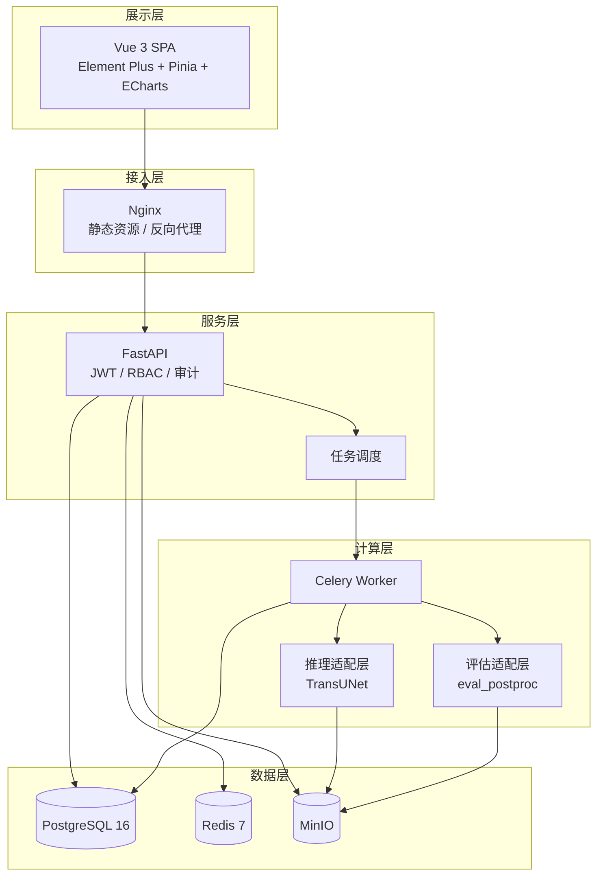

# BIDL-SP · 乳腺影像数据湖与辅助筛查平台

> Breast Imaging Data Lake & Screening Platform
>
> 面向乳腺超声筛查医生的一体化平台原型：数据接入 — 标注 — 训练评估 — 辅助筛查 — 报告审计。
>
> **本平台仅供科研/教学使用，不作为临床诊断依据。**

---

## 1. 项目简介

BIDL-SP 试图解决乳腺影像落地中的四个问题：

1. **数据分散**：影像散落在工作站与网盘，命名不统一、缺少元数据与质量校验。
2. **标注无沉淀**：掩膜以图片形式散落，无版本、无审核、无法直接用于训练。
3. **模型难落地**：训练脚本与业务系统割裂，模型版本与推理参数无法追溯。
4. **过程不可审计**：报告无法回溯到影像、模型版本、复核人与签发人。

平台在现有 TransUNet + BUSI 复现包之上，补齐数据湖、标注与筛查业务三层，形成可演示、可追溯的完整闭环。

---

## 2. 项目状态

| 部分 | 状态 | 说明 |
|---|---|---|
| 需求分析 | 已完成 | [需求分析.md](需求分析.md) |
| 详细设计 | 已完成 | [详细设计.md](详细设计.md) |
| 接口规范 | 已完成 | [接口规范.md](接口规范.md)，64 个接口 |
| 分工文档 | 已完成 | [分工.md](分工.md) |
| 算法复现包 | 已完成 | 代码、冻结划分、指标与核验脚本已入库；BUSI 与 3 个权重因体积不入 Git，使用说明见 [transunet/README.md](transunet/README.md) |
| 算法服务（成员 B） | 已完成 | `algo/`：模型注册、推理适配、离线评估、Celery Worker、CLI；`python -m algo.cli --help` |
| 平台后端（成员 A） | 已实现，待交叉验收 | `backend/`：64 个 API、数据库迁移、数据湖、标注/筛查/报告、JWT/RBAC、审计、Worker 对接 |
| 平台前端（成员 C） | UI 已完成，联调中 | `frontend/`：14 个页面与核心组件；仅调用真实 `/api/v1` 接口，不再内置 Mock 数据 |
| 部署编排 | 已提供 | `deploy/`：Compose、初始化、健康检查、Nginx；见第 6.3 节 |

成员 A 后端已实现，启动与测试见第 6.4 节；真实 BUSI 严格去重为 779 张，原文 780 张验收目标存在跨类别重复冲突，证据见 [busi-acceptance.json](docs/evidence/busi-acceptance.json)。真实权重不入 Git，本地工作区已具备；Compose 部署需执行 `seed-models` 导入。

---

## 3. 核心能力

- **数据湖**：原始层 / 标准化层 / 数据集版本三层分离，sha256 去重，冻结划分可复现。
- **标注闭环**：标注任务、掩膜编辑器、模型预标注、审核仲裁、版本与唯一性约束。
- **算法服务**：复用 TransUNet 权重与推理口径，异步任务、结果缓存、质量标记、模型启停。
- **筛查工作台**：患者/检查建档、工作列表、影像查看器、模型结果复核、操作时间线。
- **报告与审计**：模板化报告、双人审核签发、PDF 归档、全链路审计与统计看板。

---

## 4. 系统架构



技术栈：Vue 3 + TypeScript + Element Plus / FastAPI + SQLAlchemy + Alembic / PostgreSQL 16 / Redis 7 / MinIO / Celery / PyTorch 2.5.1 + TransUNet。

---

## 5. 目录结构

```text
BIDL-SP/
├─ README.md                 # 本文件
├─ 需求分析.md                # 需求、角色、FR/NFR、验收标准
├─ 详细设计.md                # 架构、模块、数据模型、算法、前端、部署、测试
├─ 接口规范.md                # REST API 契约、对象模型、错误码、示例
├─ 分工.md                    # 3 人团队 WBS、归属、里程碑、协作规范
├─ transunet/                 # 现有算法复现包（可直接运行）
│  ├─ README.md
│  ├─ code/                   # models / busi_common / eval_postproc / train_supervised
│  ├─ data/
│  │  ├─ Dataset_BUSI_with_GT/ # benign 437、malignant 210、normal 133
│  │  └─ splits/busi_seed0.json
│  ├─ results/                # 3 个种子权重、指标 JSON、sha256
│  ├─ scripts/verify_metrics.py
│  ├─ env/                    # 环境记录与依赖
│  └─ TransUNet/              # 官方仓库，commit 02ef001
├─ algo/                      # 算法服务（成员 B，已实现）
│  ├─ adapter/                # registry / predictor / metrics / RLE / config
│  ├─ worker/                 # Celery tasks + 离线评估适配
│  ├─ models/registry.json    # 3 个种子、权重 sha256 与指标
│  ├─ tests/                  # pytest
│  └─ cli.py                  # 模型/推理/评估/回归命令
├─ backend/                  # 成员 A：API、迁移、测试、验收脚本
├─ deploy/                   # 成员 A：Compose、Nginx、初始化和运维
└─ frontend/                 # 成员 C：UI 已完成，仅调用真实接口
```

> BUSI 数据与 3 个权重已在本地工作区，但被根目录 `.gitignore` 排除，不随 Git 分发；新环境请按 [transunet/README.md](transunet/README.md) 放置数据，并从课程提交包/网盘获取权重后放入 `transunet/results/`。

---

## 6. 快速开始

### 6.1 复现算法指标（当前可运行）

前置：Python 3.10–3.12（推荐 3.11；如使用 3.13 需确认 PyTorch 轮子可用），磁盘预留 ≥ 6 GB。

> 从 Git 克隆的仓库不含 BUSI 与权重，请先按上一节说明放置数据与权重；当前本地工作区已具备。

**Windows PowerShell**

```powershell
cd transunet
python -m venv .venv
.venv\Scripts\Activate.ps1
pip install -r env/requirements.txt
python scripts/verify_metrics.py
```

**Linux / macOS**

```bash
cd transunet
python -m venv .venv
source .venv/bin/activate
pip install -r env/requirements.txt
python scripts/verify_metrics.py
```

期望输出最后一行：`RESULT: PASS`。

数据自检：

```powershell
cd transunet\code
python -c "from busi_common import build_index, load_split; print(len(build_index()), load_split()['counts'])"
```

期望：`780 {'train': 546, 'val': 118, 'test': 116}`（算法复现包口径）。平台严格 SHA256 去重后的口径为 779 张、545/118/116，见第 11 节与 [待解决问题](docs/待解决问题.md)。

单图完整推理：

```powershell
cd transunet\code
python -u eval_postproc.py --ckpt ..\results\p1_transunet_seed0.pth `
    --model transunet --size 256 --rgb --seed 0 --tta --scales 1.0 `
    --out-tag rerun_s256rgb
```

输出 `transunet/results/rerun_s256rgb_seed0.json`。CPU 模式耗时较长，属正常现象。

> `--scales 1.0` 不能改：TransUNet 使用固定位置编码，多尺度 TTA 会破坏位置编码。

### 6.2 算法服务 CLI（成员 B，当前可运行）

```powershell
pip install -r algo/requirements.txt

# 列出注册模型（3 个种子）
python -m algo.cli models

# 校验 3 个权重的 sha256
python -m algo.cli verify

# 启用/回滚模型版本（本地 registry.json）
python -m algo.cli activate --model s256rgb-seed1

# 单图推理：输出 mask / overlay / result.json 到 algo/outputs/
python -m algo.cli predict `
  --image "transunet/data/Dataset_BUSI_with_GT/benign/benign (1).png"

# 指标回归：期望 RESULT: PASS，可同时写入证据文件
python -m algo.cli verify-metrics --output algo/reports/regression.json

# 完整离线评估（CPU 较慢，输出 A2+A1 / A2+A1+A3 并自动比对登记值）
python -m algo.cli evaluate --model s256rgb-seed0 --device cpu
```

CLI 输出的 `result` 字段与 [接口规范.md](接口规范.md) 5.5.5 对齐（`mask_rle`、`prob_mean`、`lesion_area_ratio`、`quality_flags`、`elapsed_ms`）。批量/异步调用使用 `algo.worker.tasks:execute_inference`，Celery 启动方式见 6.4。

### 6.3 平台部署（Docker Compose）

Docker 24+、Compose v2，建议 8 vCPU / 16 GB RAM / 50 GB SSD；在仓库根目录执行：

```powershell
# Windows 一键启动（仓库根目录）
.\start.ps1

# 等价的部署目录入口
.\deploy\start.ps1

# 如果系统禁止运行脚本：
powershell -ExecutionPolicy Bypass -File .\start.ps1
```

常用参数：

```powershell
.\start.ps1 -SkipFrontend                 # 复用已有 deploy/html
.\start.ps1 -Build                        # 强制重新构建镜像（默认仅在镜像缺失时构建）
.\start.ps1 -NoDemo                       # 不创建演示账号
.\start.ps1 -WithMinio                    # 额外启动 MinIO（对象存储切到 minio）
.\start.ps1 -ModelRoot D:\BIDL-assets     # 额外注册三份真实权重
.\start.ps1 -DatasetDir D:\Dataset_BUSI_with_GT  # 额外导入 BUSI
.\start.ps1 -Down                         # 停止并移除容器（保留数据卷）
```

Linux/macOS 可手动执行：

```bash
python deploy/generate_env.py
docker compose --env-file deploy/.env -f deploy/docker-compose.yml up -d --build
docker compose --env-file deploy/.env -f deploy/docker-compose.yml ps
```

`init` 等待 PostgreSQL 健康后执行 Alembic、初始化存储与 admin；`api`、worker 与调度器等待初始化成功。首次 Worker 镜像需下载 PyTorch CPU 包，耗时取决于网络。

对象存储默认使用本地共享卷 `runtime-data`（`STORAGE_BACKEND=local`），不依赖 MinIO，一键脚本因此不触发额外的镜像构建。MinIO 历史 Docker Hub 镜像已下架，`deploy/minio.Dockerfile` 会从固定提交 `f19c534b9f457773dcd043d977433e1a71525c3b` 编译，只有在 `-WithMinio` 时才构建，且要求容器内能访问 GitHub 与 Go 模块代理。Worker 拉取固定 TransUNet commit `02ef0010b36eb8328b5e689eadaf613602edf9b8`。CPU 本地开发应先执行 `git submodule update --init transunet/TransUNet`。

- API 文档：`http://localhost:8080/docs`
- 就绪检查：`http://localhost:8080/api/v1/readyz`
- MinIO 控制台：`http://localhost:9001`（仅 `-WithMinio`）
- 演示管理员：`admin` / `DemoPassword!123`（固定写死，登录页自动填充并展示）。

服务默认只绑定本机。局域网演示时需同时调整 Nginx/MinIO 端口绑定、`MINIO_PUBLIC_ENDPOINT` 和 `CORS_ORIGINS`；外网部署应在入口加 HTTPS，不要公开 PostgreSQL/Redis 端口。

前端构建并复制到 Nginx 目录：

```bash
python deploy/build_frontend.py
# 已安装 node_modules 时可跳过 npm ci
python deploy/build_frontend.py --skip-install
# 源码未变化时强制重新构建
python deploy/build_frontend.py --force
```

脚本会对 `frontend/src`、`index.html`、`package-lock.json` 等构建输入计算内容哈希：未变化时直接复用 `frontend/dist` 与 `deploy/html`，跳过 Vite 构建和复制；改了源码才重新构建。构建产物不进入 Git。未执行脚本前，首页仍是后端交接入口。

### 6.4 后端运行（仅 PostgreSQL）

平台只使用 PostgreSQL，不再提供 SQLite 本地模式。`DATABASE_URL` 必须显式提供，本地与演示统一通过第 6.3 节 Compose 启动；`init` 容器自动完成迁移、存储初始化与演示账号写入。

- 演示管理员：`admin` / `DemoPassword!123`（固定写死，登录页自动填充并展示）
- 前端可自助注册，新账号默认 `disabled`、角色 `screener`，需管理员在“用户管理”启用
- 接口文档：`http://localhost:8080/docs`
- 任务由 Beat → dispatcher → Redis → Worker 自动执行，不需要本地手工调度

固定密码仅用于科研演示/联调；正式部署前必须修改管理员密码并移除前端提示。后端测试使用独立的临时数据库，直接运行 `pytest backend/tests` 即可，不影响 Compose 数据。

### 6.5 数据与模型初始化

服务器管理员通过 Compose 的一次性 `init` 容器执行：

```powershell
# 目录导入：把宿主机数据集只读挂载进容器
docker compose --env-file deploy/.env -f deploy/docker-compose.yml run --rm `
  -v D:/datasets/Dataset_BUSI_with_GT:/dataset:ro `
  init python -m app.cli import-directory /dataset --dataset BUSI

# 导入三份真实权重并逐份验证 SHA256
docker compose --env-file deploy/.env -f deploy/docker-compose.yml run --rm `
  -v D:/BIDL-assets:/assets:ro `
  init python -m app.cli seed-models --root /assets
```

演示环境可一键灌入完整闭环数据（需本地 BUSI 与权重，且 Compose 已启动）：

```powershell
python backend/scripts/seed_demo.py
```

脚本会导入真实 BUSI、注册 3 个权重、冻结数据集版本，并生成标注（已通过/草稿/待领取）、筛查（已签发报告/待审核报告/待复核/待领取）和真实 CPU 推理结果。导入是幂等判断：已有数据时跳过对应步骤。当前本地 `normal (62).png` 为 0 字节，导入会记录 1 条失败，因此实际入湖 **778 张**，冻结划分 544/117/117。

`--root` 下应包含 `transunet/results/p1_transunet_seed{0,1,2}.pth`。也可先通过 MinIO 上传，再调用模型注册 API；服务端再次计算 SHA256。注册后 API 的版本 UUID、参数、权重摘要传给 B 的 `Predictor`，不依赖 B 的本地 JSON 启用状态。

真实 BUSI 有一对跨类别完全相同图像：`benign (433).png` / `malignant (145).png`。平台严格执行 SHA256 唯一约束，保留 benign 首份，重复及类别冲突写入导入报告。实测为 **779 张 = 437/209/133**；保留官方清单其余成员原划分，得到 **545/118/116**，验证/测试集不变，证据见 [busi-acceptance.json](docs/evidence/busi-acceptance.json)。不能写成“780 张且重复 0”。

默认 `split_seed=0` 复用 `busi_seed0.json`；manifest 记录 `effective_seed=42`、`split_source` 和 `excluded_duplicates`。冻结保存当时的 approved 标注 ID、版本与掩膜对象键，后续审核不会改变旧 manifest。公共 BUSI 参考掩膜导入为 `source=import,status=approved`，备注明确不是人工审核。

### 6.6 事务、任务恢复与报告安全

- 任务与 outbox 在同一数据库事务中提交，Beat 每 5 秒调度；Broker 暂停不丢失已接受的请求。
- 推理/评估用条件更新保证单次领取，结果写数据库与私有对象存储；GET 查询读取数据库，不依赖 Celery 临时 result backend。
- 推理缓存键包括图像 SHA256、权重 SHA256、完整模型配置和本次参数；结果仍有独立任务记录。
- Worker 超时会落库为 failed；修复后重新提交，复用相同幂等键会返回原失败任务，重试应使用新键。
- 审核、签发、冻结使用 PostgreSQL 行锁，唯一索引兜底。
- 审计表数据库触发器拒绝 UPDATE/DELETE；签发报告、冻结版本及其成员不可改写。

报告先完成筛查复核，再起草/保存新版本、提交、签发。审核人和起草人分离；管理员自签必须提供理由并单独审计。报告保存模板及血缘快照，已签发 PDF 不重新渲染；草稿预览有“未签发”水印。模板只接受白名单标签和简单变量，禁止执行 Jinja 循环、函数或属性访问。PDF 使用 ReportLab；Compose 内嵌文泉驿字体，Windows 自动使用系统宋体，可用 `PDF_FONT_PATH` 指定授权字体。

JWT 8 小时，登出吊销 jti，改密/角色变更吊销旧令牌；接口权限从数据库实时读取。原图仅 admin/data_engineer，manifest 导出仅 admin；预览/掩膜走 300 秒签名 URL。DICOM 不在首版范围内。归档冻结版本：`docker compose --env-file deploy/.env -f deploy/docker-compose.yml run --rm init python -m app.cli archive-version <UUID>`，只改变生命周期状态，manifest、成员和标注引用保持不变。

### 6.7 部署冒烟、故障处理与备份

在全新测试环境启动全部服务后执行：

```bash
python backend/scripts/smoke_compose.py
```

脚本创建 `compose-smoke` 数据集并上传合成 PNG，等待 Beat → dispatcher → Redis → Worker 完成异步导入，验证 MinIO 签名下载和匿名拒绝；不验证模型精度。演示账号初始化：

```bash
docker compose --env-file deploy/.env -f deploy/docker-compose.yml run --rm init python -m app.cli seed-demo
```

算法权重不入 Git、不打入镜像；挂载只读资产目录后初始化：

```bash
docker compose --env-file deploy/.env -f deploy/docker-compose.yml run --rm -v /absolute/assets:/assets:ro init python -m app.cli seed-models --root /assets
docker compose --env-file deploy/.env -f deploy/docker-compose.yml run --rm -v /absolute/Dataset_BUSI_with_GT:/dataset:ro init python -m app.cli import-directory /dataset
```

也可在 `/docs` 通过 ZIP 上传；单图 ≤ 20 MB，ZIP 压缩及解压总量各 ≤ 2 GB，最多 2000 个文件。

故障处理：

```bash
docker compose --env-file deploy/.env -f deploy/docker-compose.yml logs --tail 100 api worker dispatcher scheduler
docker compose --env-file deploy/.env -f deploy/docker-compose.yml restart worker
docker compose --env-file deploy/.env -f deploy/docker-compose.yml run --rm init python -m app.cli dispatch-once
```

任务 queued 检查 scheduler/dispatcher/Redis；running 长时间无结果检查 worker 和内存；failed 查 task_id 日志。修复后新建任务，不复用原幂等键。模型回滚调用旧版本 activate，历史结果参数不变。

备份与恢复：暂停写请求和 Worker，保留数据库、MinIO 桶和配置密钥；Redis 不是唯一任务事实来源。示例：

```bash
docker compose --env-file deploy/.env -f deploy/docker-compose.yml exec -T db pg_dump -U bidl -d bidlsp -Fc > bidlsp.dump
```

MinIO 用 `mc mirror` 备份各私有桶，凭据在运维端交互配置。恢复时先启动空 PostgreSQL/MinIO，恢复桶对象，再用 `pg_restore --clean --if-exists` 恢复数据库，执行迁移并启动 API/Worker；`--clean` 仅用于明确选定的恢复目标库。验收至少检查 readyz、登录、1 张原图、冻结 manifest、1 份历史 PDF 与审计。

---

## 7. 使用流程

1. **数据接入**：上传 BUSI ZIP，系统校验命名、掩膜配对、尺寸与 sha256，输出导入报告。
2. **数据集版本**：平台按严格去重口径冻结为 545/118/116；算法复现包保留 546/118/116。
3. **标注**：生成标注任务，模型预标注 → 人工修正 → 提交 → 审核通过。
4. **模型**：注册 3 个种子权重，离线评估并登记指标，启用 seed 0 为在线版本。
5. **筛查**：建档 → 工作列表领取 → 查看影像 → 触发推理 → 医生复核。
6. **报告**：起草 → 提交审核 → 签发 → 导出 PDF；全程写审计日志。

---

## 8. 算法基线

3 个种子（150 epoch）在测试集 116 张上的均值：

| 变体 | Dice | 精确率 | 召回率 | 正常图前景占比 | HD95(px) |
|---|---|---|---|---|---|
| baseline | 0.7002 ± 0.0348 | 0.8416 | 0.7405 | 0.00365 | 106.8 |
| A2+A1 | 0.6943 ± 0.0322 | 0.8664 | 0.7377 | 0.00195 | 115.4 |
| A2+A1+A3 | 0.7087 ± 0.0371 | 0.7896 | 0.7929 | 0.00573 | 96.2 |

单种子参考（seed 0，CPU 已实跑核对）：baseline 0.7293 / A2+A1 0.7240 / A2+A1+A3 0.7318。

说明：

- A1（后处理）降低正常图假阳、提高精确率，但会把小病灶判空，导致 HD95 上升（106.8 → 115.4）。
- 测试集仅 20 张正常图，正常图指标只能作点估计，不做统计显著性结论。
- 引用请使用 3 种子均值；单种子波动约 ±0.03。

---

## 9. 文档索引

| 文档 | 内容 |
|---|---|
| [需求分析.md](需求分析.md) | 背景、角色、场景、用例、约 50 条功能需求、14 条非功能需求、验收标准 |
| [详细设计.md](详细设计.md) | 架构、模块、24 张表、接口摘要、算法、前端、安全、部署、测试、追踪矩阵 |
| [接口规范.md](接口规范.md) | `/api/v1` 通用约定、64 个接口、对象模型、错误码、请求示例 |
| [分工.md](分工.md) | 3 人角色、12 个工作包、模块归属、里程碑、协作规范、交叉备份 |
| [docs/待解决问题.md](docs/待解决问题.md) | 当前问题、优先级、验收标准与处理记录 |
| [docs/evidence/](docs/evidence) | 后端、BUSI、Compose、真实 E2E 证据 |
| [transunet/README.md](transunet/README.md) | 算法包使用说明、权重身份、已知坑 |

---

## 10. 配置项

| 变量 | 说明 | 示例 |
|---|---|---|
| `DATABASE_URL` | PostgreSQL 连接串 | `postgresql+psycopg://bidl:****@db:5432/bidlsp` |
| `REDIS_URL` | Celery Broker/缓存 | `redis://redis:6379/0` |
| `MINIO_ENDPOINT` | 对象存储地址 | `minio:9000` |
| `MINIO_ACCESS_KEY` / `MINIO_SECRET_KEY` | 对象存储凭据 | 部署时生成 |
| `JWT_SECRET` | JWT 签名密钥 | 随机 32 字节 |
| `MODEL_CACHE_DIR` | 权重缓存目录 | `/models` |
| `DEVICE` | 推理设备 | `cpu` / `cuda` |
| `MAX_UPLOAD_MB` | 上传大小上限 | `20` |
| `TRANSUNET_ROOT` | 官方仓库路径 | `/opt/bidl/transunet/TransUNet` |
| `PYTHONPATH` | 复用 `busi_common` | `/opt/bidl/transunet/code` |
| `BIDLSP_MODEL_REGISTRY` | 模型注册表路径 | `algo/models/registry.json` |
| `BIDLSP_ALGO_OUTPUT_DIR` | 推理产物目录 | `algo/outputs` |

---

## 11. 测试与验收

```bash
# 算法服务单测（当前可运行）
python -m pytest algo/tests -q

# 慢速一致性测试：适配层输出需与已记录 A2+A1 单图 Dice 一致
$env:RUN_SLOW_TESTS='1'; python -m pytest algo/tests/test_predictor.py -q

# 算法回归（当前可运行）
cd transunet && python scripts/verify_metrics.py        # 期望 RESULT: PASS

# 后端与前端（当前可运行）
cd backend && pytest
cd frontend && npm run type-check && npm run build
```

验收要点：

- 平台严格去重入湖 779 张，计数 437/209/133，重复 1 条（跨类别同 SHA256，已记录）；原始 BUSI 为 780 个文件。
- 平台数据集版本 545/118/116；算法复现包保留 546/118/116。
- seed 0 单图 A2+A1 Dice = 0.7240（容差 1e-3）。
- 筛查—报告—PDF 全链路可演示，RBAC 与审计通过。
- 全站与报告固定展示免责声明。

完整清单见 [需求分析.md](需求分析.md) 第 8 章与 [分工.md](分工.md) 第 10 章。

---

## 12. 常见问题

**Q1：为什么 A2+A1 的 Dice 比 baseline 低？**
A1 会丢弃面积占比 < 0.1% 的预测，能降低正常图假阳并提高精确率，但小病灶被误判为空时 Dice 下降、HD95 上升。因此平台同时保留原始掩膜与后处理掩膜，指标分开登记。

**Q2：为什么不能做多尺度 TTA？**
TransUNet 使用固定位置编码，多尺度输入会破坏位置编码；本方案只做水平翻转，命令中 `--scales 1.0` 不能省。

**Q3：CPU 能跑吗？**
可以。2026-10-30 已在纯 CPU 环境完成 seed 0 端到端复跑，结果与 GPU 记录值逐位一致；速度较慢，平台采用异步任务与结果缓存。

**Q4：为什么正常图指标波动大？**
测试集只有 20 张正常图，只能作点估计；请引用 3 种子均值与标准差。

**Q5：数据和权重为什么不建议进 Git？**
BUSI 约 2 GB、单权重约 421 MB。当前本地工作区为便于复现已包含数据与权重，但根目录 `.gitignore` 已排除，不随 Git 分发；正式仓库建议放对象存储/网盘，仓库仅保留 manifest 与 sha256。

**Q6：TransUNet 可以换版本吗？**
不可以直接换。权重依赖 commit `02ef0010b36eb8328b5e689eadaf613602edf9b8`，换版本可能导致 `state_dict` 键名不匹配；升级必须重跑指标回归。

---

## 13. 数据与合规

- 数据：BUSI（Al-Dhabyani et al., Data in Brief 2020），公开科研数据。
- 平台不存储姓名、证件号、联系方式等直接身份标识；预留 DICOM 接入时先做脱敏。
- 界面、报告与演示材料必须保留「仅供科研/教学使用，不作为临床诊断依据」。
- 第三方资产遵循其原始许可：BUSI 数据集许可、TransUNet 仓库 LICENSE。

---

## 14. 贡献与分工

3 人团队分工、工作包、评审矩阵与交叉备份见 [分工.md](分工.md)。协作约定：

- `main` 受保护，`dev` 集成，`feat/<模块>-<描述>` 开发；
- PR 至少 1 人评审，接口变更先改 [接口规范.md](接口规范.md)；
- 数据与权重不进 Git，文档与代码同 PR 更新；
- 完成定义：代码 + 测试 + 文档 + 评审 + 可演示。

---

## 15. 致谢

- BUSI 数据集作者与公开镜像维护者。
- TransUNet 官方仓库（Beckschen/TransUNet）。
- 课程指导教师与评审人。


### 成员 A 交付入口

- 后端运行、数据/模型初始化、Compose 部署、故障处理与备份见本文件第 6.3–6.7 节
- [真实 BUSI 导入与冻结证据](docs/evidence/busi-acceptance.json)
- [后端测试与 Compose 证据](docs/evidence/backend-tests.xml)、[compose-ci.json](docs/evidence/compose-ci.json)
