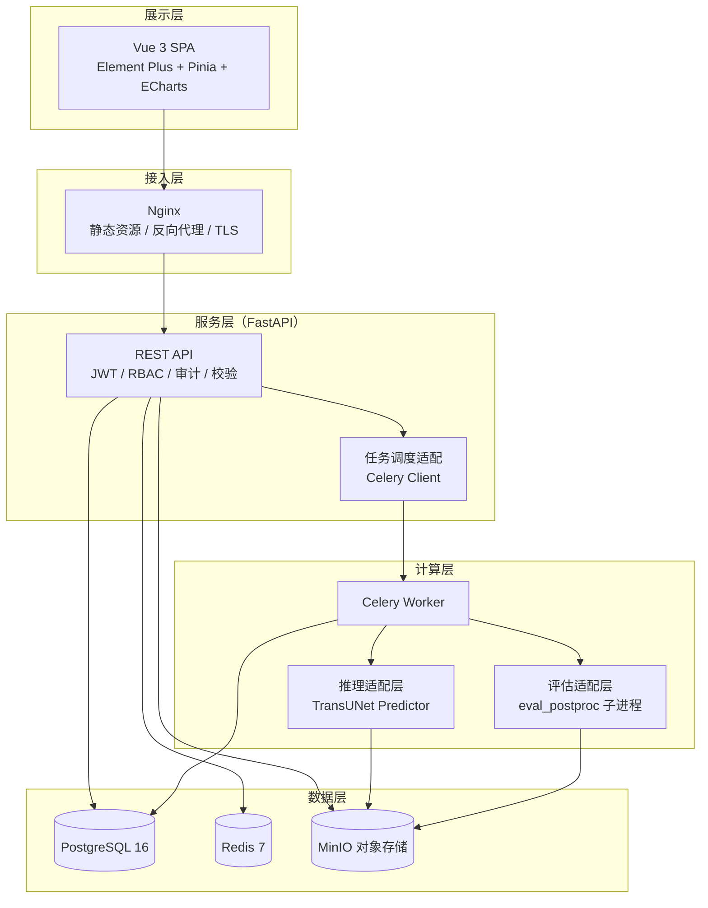
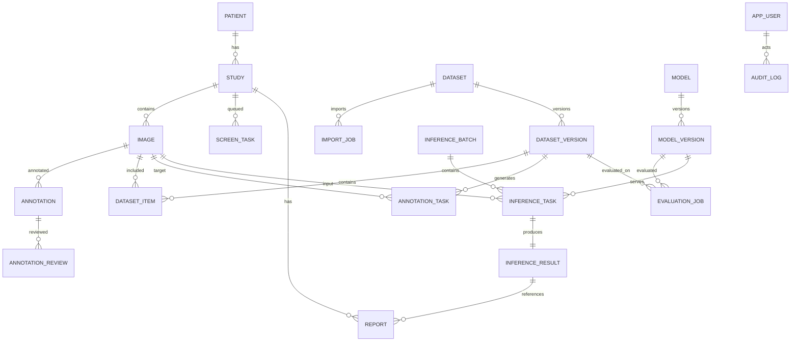
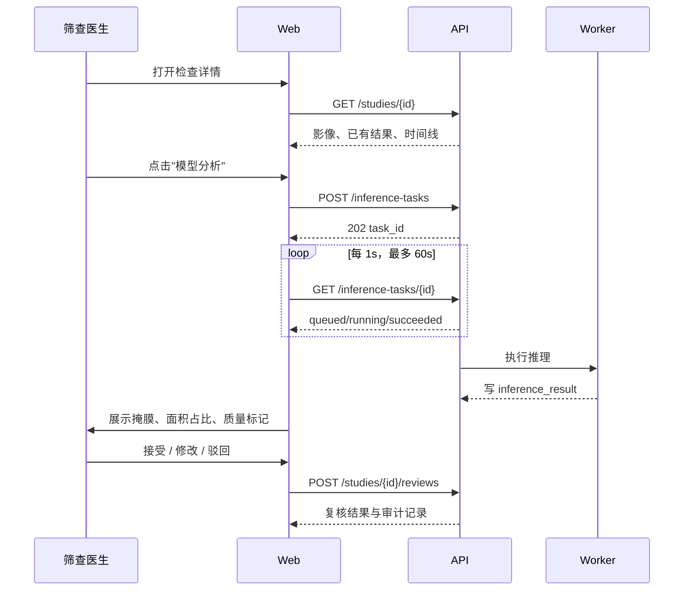

# 乳腺影像数据湖与辅助筛查平台（BIDL-SP）

## 详细设计文档

| 项 | 内容 |
|---|---|
| 文档版本 | v1.0 |
| 编写日期 | 2026-10-30 |
| 文档状态 | 评审稿 |
| 对应需求 | `需求分析.md` v1.0 |
| 适用范围 | 课程/科研原型，单中心、Docker Compose 部署 |

---

## 1. 概述

### 1.1 设计目标

在现有 TransUNet + BUSI 复现包之上，构建一个"数据可管、标注可用、模型可复现、筛查可追溯"的平台原型。设计需保证：

1. **算法口径不变**：平台推理与 `transunet/code/eval_postproc.py` 的同参数结果一致，指标可用 `verify_metrics.py` 复核。
2. **数据不重复治理**：原始层、标准化层、数据集版本三层分离，冻结版本不可变。
3. **业务闭环**：检查建档 → 推理 → 医生复核 → 报告签发 → 审计统计。
4. **3 人可交付**：优先 P0，模块边界清晰，接口契约先行，避免前后端互相等待。

### 1.2 设计原则

| 原则 | 落地方式 |
|---|---|
| 契约先行 | FastAPI 自动生成 OpenAPI；前端据此生成 TS 类型与请求封装 |
| 算法隔离 | Web 进程不加载 PyTorch 模型；推理与评估在独立 Worker 进程执行 |
| 数据不可变 | 原始对象只增不改；数据集版本冻结后只读；审计日志只追加 |
| 最小权限 | 接口级 RBAC；对象存储私有桶 + 短时签名 URL |
| 可追溯 | 推理结果记录模型版本、参数、耗时；报告记录起草/审核/签发人 |
| 渐进增强 | 先 CPU 单机跑通，再按需启用 GPU、批量推理、DICOM |

### 1.3 与需求文档的对应

| 需求域 | 需求编号 | 设计章节 |
|---|---|---|
| 数据湖与治理 | FR-DAT-01 ~ 09 | 3.2、4、5 |
| 标注 | FR-ANN-01 ~ 08 | 3.3、4、5、7 |
| 模型与推理 | FR-MDL-01 ~ 08 | 3.4、6 |
| 筛查工作台 | FR-SCR-01 ~ 07 | 3.5、7 |
| 报告 | FR-RPT-01 ~ 06 | 3.6、7 |
| 平台管理 | FR-ADM-01 ~ 05 | 3.7、8 |
| 统计 | FR-STA-01 ~ 04 | 3.8、7 |
| 非功能 | NFR-01 ~ 14 | 8、9、10、11 |

### 1.4 术语

沿用 `需求分析.md` 第 1.3 节；本文件额外使用：

| 术语 | 说明 |
|---|---|
| ODS / DWD / DWS | 原始层 / 标准化明细层 / 数据集汇总层，借数据仓库分层命名 |
| manifest | 数据集版本的清单文件，含文件、标签、划分、sha256 |
| 适配层 | 平台与 `transunet/` 复现包之间的薄封装，负责加载、推理、结果转换 |
| 质量标记 | 推理结果的异常提示，如空掩膜、面积过大、低置信度 |

---

## 2. 总体架构

### 2.1 逻辑架构



### 2.2 部署拓扑

单机 Docker Compose，所有服务同一宿主机；生产化可拆分为独立节点。

| 服务 | 镜像/运行时 | 职责 | 端口 |
|---|---|---|---|
| `nginx` | nginx:1.27-alpine | 托管前端静态文件、反向代理 `/api`、限制上传大小 | 80/443 |
| `web` | 构建产物（Vue 3） | 前端 SPA | 由 nginx 托管 |
| `api` | python:3.11-slim + FastAPI | REST API、鉴权、审计、任务投递 | 8000（内网） |
| `worker` | 同 api 镜像 + torch | 推理、批量推理、离线评估 | 无对外端口 |
| `db` | postgres:16 | 元数据、业务数据、审计 | 5432（内网） |
| `redis` | redis:7 | Celery Broker/Result、缓存、登录限流 | 6379（内网） |
| `minio` | minio/minio | 影像、掩膜、权重、报告 PDF | 9000/9001（内网） |

卷：`pgdata`、`miniodata`、`model_cache`、`logs`。GPU 模式通过 `docker compose --profile gpu` 启用 `worker-gpu`，其余服务不变。

### 2.3 技术选型

| 层 | 选型 | 版本建议 | 理由 |
|---|---|---|---|
| 前端 | Vue 3 + Vite + TypeScript | Vue 3.5 / Vite 6 | 上手快、生态全、适合 3 人团队 |
| UI | Element Plus | 2.8+ | 表格、表单、对话框开箱即用 |
| 图表 | ECharts | 5.5+ | 指标与统计看板 |
| 状态 | Pinia | 2.2+ | 轻量，配合组合式 API |
| 后端 | FastAPI + SQLAlchemy 2.0 + Alembic | FastAPI 0.115 / SQLAlchemy 2.0 | 自动 OpenAPI、类型校验、迁移成熟 |
| 数据库 | PostgreSQL 16 | 16.x | JSONB、部分唯一索引、事务可靠 |
| 队列 | Celery + Redis | Celery 5.4 / Redis 7 | 异步推理、重试、结果后端 |
| 对象存储 | MinIO | 最新稳定版 | S3 兼容、单机易部署 |
| 算法 | PyTorch 2.5.1 + TransUNet（commit `02ef001`） | 与复现包一致 | 权重可加载、指标可复现 |
| 报告 | WeasyPrint（HTML→PDF） | 62+ | 模板即 HTML，中文字体可控 |
| 测试 | pytest + httpx + Playwright | 最新稳定版 | 单元/集成/E2E |

### 2.4 代码组织

```text
BIDL-SP/
├─ 需求分析.md
├─ 详细设计.md
├─ 分工.md
├─ backend/
│  ├─ app/
│  │  ├─ main.py                 # FastAPI 入口
│  │  ├─ core/                   # 配置、鉴权、RBAC、审计、错误码
│  │  ├─ models/                 # SQLAlchemy ORM
│  │  ├─ schemas/                # Pydantic 请求/响应
│  │  ├─ api/v1/                 # 路由：auth/data/ann/model/screen/report/stats
│  │  ├─ services/               # 业务服务：导入、数据集、标注、报告
│  │  └─ tasks/                  # Celery 任务定义
│  ├─ alembic/                   # 数据库迁移
│  └─ tests/
├─ frontend/
│  ├─ src/
│  │  ├─ api/                    # OpenAPI 生成的客户端
│  │  ├─ views/                  # 页面
│  │  ├─ components/             # ImageViewer、MaskCanvas、ResultPanel 等
│  │  ├─ stores/                 # Pinia
│  │  └─ router/
│  └─ vite.config.ts
├─ algo/
│  ├─ adapter/
│  │  ├─ predictor.py            # 模型加载、预处理、TTA、后处理
│  │  ├─ metrics.py              # 复用 busi_common 指标
│  │  └─ registry.py             # 模型版本与权重缓存
│  └─ worker/
│     ├─ inference_worker.py     # Celery 推理任务
│     └─ eval_worker.py          # 离线评估子进程封装
├─ deploy/
│  ├─ docker-compose.yml
│  ├─ nginx.conf
│  └─ .env.example
└─ transunet/                    # 现有复现包，只读引用，不修改
```

**算法复用方式**：镜像构建时将 `transunet/` 复制到 `/opt/bidl/transunet`，设置 `PYTHONPATH=/opt/bidl/transunet/code` 与 `TRANSUNET_ROOT=/opt/bidl/transunet/TransUNet`；`algo/adapter` 只调用 `build_model`、`busi_common` 的纯函数与 `train_supervised.prob_to_original`，不修改原文件。升级复现包必须重跑指标回归。

### 2.5 关键设计取舍

| 决策 | 选择 | 放弃的方案 | 原因 |
|---|---|---|---|
| 推理执行位置 | Celery Worker 独立进程 | Web 进程内直接推理 | 避免 105.3M 参数模型拖垮 API、避免 GIL 阻塞 |
| 离线评估 | 子进程调用 `eval_postproc.py` | 在服务内重写评估逻辑 | 保证与登记指标同口径，减少回归风险 |
| 掩膜传输 | RLE（JSONB） | 前端传 PNG 文件 | 体积小、可版本化、无需额外对象 |
| 影像存储 | MinIO + 元数据库 | 直接存数据库 BLOB | 大文件不入库，便于备份与流式读取 |
| 权限模型 | 角色 + 接口装饰器 | 细粒度 ACL | 5 类角色已足够，降低复杂度 |
| 数据集 | 不可变版本 + manifest | 直接对目录打标 | 可复现、可审计、防误改 |

---

## 3. 模块设计

### 3.1 模块总览

| 模块 | 职责 | 关键实现 | 对应需求 |
|---|---|---|---|
| M1 数据接入与治理 | 导入、校验、去重、标准化、数据集版本 | `services/ingest.py`、`services/dataset.py` | FR-DAT-01 ~ 09 |
| M2 标注子系统 | 任务、掩膜编辑、预标注、审核 | `services/annotation.py`、`MaskCanvas` | FR-ANN-01 ~ 08 |
| M3 算法服务 | 模型注册、离线评估、在线/批量推理 | `algo/adapter`、`tasks/inference.py` | FR-MDL-01 ~ 08 |
| M4 筛查工作台 | 建档、工作列表、查看器、复核 | `services/screening.py`、`ImageViewer` | FR-SCR-01 ~ 07 |
| M5 报告 | 模板、生成、审核签发、PDF | `services/report.py`、WeasyPrint | FR-RPT-01 ~ 06 |
| M6 平台基础 | 认证、RBAC、审计、配置 | `core/security.py`、`core/audit.py` | FR-ADM-01 ~ 05 |
| M7 统计 | 总览与分域统计 | `services/stats.py` | FR-STA-01 ~ 04 |

### 3.2 M1 数据接入与治理

#### 3.2.1 导入流水线


导入任务状态：`pending → validating → importing → completed / failed`；单文件失败不阻塞整体，失败原因写入 `import_report` 明细（可存任务 JSON）。

#### 3.2.2 校验规则

| 规则 | 处理 |
|---|---|
| 文件名必须匹配 `类别 (n).png`（类别为 benign/malignant/normal）或 `*_mask.png` | 不匹配进失败清单 |
| 掩膜名 = 图像名 + `_mask.png`；多病灶为 `_mask_1.png` 等 | 缺失掩膜时允许导入但标记 `mask_missing` |
| 掩膜与图像尺寸一致 | 不一致时最近邻缩放并警告 |
| 图像可被 PIL 解码 | 失败进失败清单 |
| sha256 已存在 | 跳过，计入 `duplicate` |
| 类别目录缺失 | 导入任务失败并提示 |

#### 3.2.3 数据集版本冻结

1. 选择图像范围（全部/按类别/按标注状态/按检索条件）。
2. 选择 seed 与比例（默认 0.7/0.15/0.15，seed=0）。
3. 服务端按类别分层抽样，生成 train/val/test。
4. 校验：三集交集为空、并集等于所选集合、类别计数与预期一致。
5. 将 manifest 写入 `bidlsp-dataset` 桶，`dataset_version.status='frozen'`。
6. 冻结后禁止修改；需要变更时创建新版本。

默认口径与现有复现包一致：780 张 → 546/118/116；分类别为 benign 306/66/65、malignant 147/32/31、normal 93/20/20。

#### 3.2.4 检索与血缘

`image` 记录来源、类别、尺寸、sha256、掩膜键；`dataset_item` 记录版本归属；`annotation` 记录标注版本与审核人。任一图像可反查：所属数据集版本 → 使用的标注 → 训练/评估记录 → 推理任务。

### 3.3 M2 标注子系统

#### 3.3.1 标注任务

- 生成方式：按数据集版本 + 类别 + 数量生成；或按筛选条件批量生成。
- 领取：`POST /annotation-tasks/{id}/claim`，使用 `UPDATE ... WHERE status='pending'` 乐观锁，避免重复领取。
- 状态：`pending → in_progress → submitted → approved / rejected`；驳回后回到 `in_progress`。

#### 3.3.2 掩膜编辑

- 前端 `MaskCanvas` 维护一个与原图同尺寸的二值画布；支持画笔、橡皮、多边形、撤销/重做。
- 撤销栈保存最近 20 步的 RLE 快照（或差异），限制内存。
- 保存时统一转 RLE（按行游程），提交 `{image_id, mask_rle, source, note}`。
- 多病灶无需特殊处理：画布天然支持多个连通域；导出/训练时按逻辑或合并，与 `busi_common.load_mask` 一致。

#### 3.3.3 预标注

1. 标注页点击"模型预标注"，调用在线推理接口。
2. 将返回的 `mask_rle` 载入画布，`annotation.source='preannot'`。
3. 人工修改并保存后，`source` 改为 `manual`；保留 `model_version_id` 便于统计预标注采纳率。

#### 3.3.4 审核与唯一性

- 审核动作写 `annotation_review`，状态变更写 `annotation`。
- 每张图最多一个 `approved` 版本：部分唯一索引 `UNIQUE(image_id) WHERE status='approved'`。
- 仅 `approved` 标注可被数据集版本引用（冻结时强校验）。

### 3.4 M3 算法服务

#### 3.4.1 分层

| 层 | 文件 | 职责 |
|---|---|---|
| 适配层 | `algo/adapter/predictor.py` | 加载权重、预处理、TTA、后处理、结果编码 |
| 指标层 | `algo/adapter/metrics.py` | 包装 `busi_common.per_image_metrics` 与聚合 |
| 注册层 | `algo/adapter/registry.py` | 从数据库/对象存储取激活模型，维护本地权重缓存 |
| 任务层 | `algo/worker/inference_worker.py` | Celery 任务：单图/批量推理 |
| 评估层 | `algo/worker/eval_worker.py` | 子进程执行 `eval_postproc.py`，解析结果 JSON |

#### 3.4.2 模型注册

`model_version` 保存：

```json
{
  "name": "transunet",
  "version": "s256rgb-seed0",
  "weights_key": "models/transunet/s256rgb-seed0/weights.pth",
  "weights_sha256": "8369da00...",
  "config": {
    "size": 256,
    "in_ch": 3,
    "rgb": true,
    "tta": true,
    "scales": [1.0],
    "threshold": 0.5,
    "postproc": true,
    "min_area": 0.001,
    "seed": 0,
    "transunet_commit": "02ef0010b36eb8328b5e689eadaf613602edf9b8"
  },
  "metrics": {
    "dice": 0.7240,
    "precision": 0.8664,
    "recall": 0.7377,
    "hd95": 115.4
  },
  "status": "active"
}
```

同一模型任务只允许一个 `active` 版本：部分唯一索引 `UNIQUE(model_id) WHERE status='active'`。启用新版本时事务内将旧版本置为 `archived`。

#### 3.4.3 在线推理

1. API 校验权限与参数，写入 `inference_task(status='queued')`，投递 Celery。
2. Worker 取任务 → 置 `running` → 从 MinIO 读取原图 → 调用 Predictor → 上传掩膜/叠加图 → 写 `inference_result` → 置 `succeeded`。
3. 失败时记录 `error_code`、`error_msg`，可重试 1 次；超时 60 s。
4. 前端轮询 `GET /inference-tasks/{id}`，成功后展示结果。

#### 3.4.4 批量推理与离线评估

- 批量推理：按 `dataset_version_id` 或 `study_ids` 生成子任务，汇总进度；单条失败不终止。
- 离线评估：仅管理员可触发；Worker 以子进程运行：

```bash
python eval_postproc.py --ckpt <weights> --model transunet --size 256 --rgb \
  --seed 0 --tta --scales 1.0 --out-tag platform_<version>
```

解析输出 JSON，抽取 `variants["A2+A1"]` 与 `variants["A2+A1+A3"]` 的汇总指标写入 `model_version.metrics`，并保留原始 JSON 至对象存储。

#### 3.4.5 并发与资源

- Celery worker 默认并发 1；模型在 worker 启动时预热（空图前向一次），避免首单超时。
- GPU 模式使用独立队列 `inference.gpu`，CPU 模式使用 `inference.cpu`。
- 单进程只持有一份模型；批量任务复用同一实例。
- 结果缓存键：`sha256(image) + model_version_id + params_hash`，有效期 24 h，命中直接返回。

### 3.5 M4 筛查工作台

- 建档：创建 `patient`（脱敏）与 `study`，上传/关联 `image`；数据集图像可一键"转为筛查检查"。
- 工作列表：按状态、优先级、领取人筛选；默认只显示待处理与本人进行中。
- 查看器：`ImageViewer` 支持缩放、平移、窗宽窗位（16 位 DICOM）、掩膜叠加与透明度、原始/后处理切换。
- 复核：接受、修改（进入 `MaskCanvas`）、驳回；动作写入 `screen_task` 与审计。
- 时间线：由 `audit_log` + 任务状态生成，展示建档、推理、复核、报告节点。

### 3.6 M5 报告

- 模板：Jinja2 HTML，变量包括 `patient_no`、`study_no`、`study_date`、`model_version`、`lesion_area_ratio`、`review_conclusion`、`reviewer`、`signed_at`。
- 生成：报告内容存 JSONB（段落化），渲染时套模板；PDF 由 WeasyPrint 生成，中文字体随镜像安装（如 Noto Sans CJK）。
- 状态机：`draft → pending_review → signed / rejected`；驳回回到 `draft`。
- 职责分离：`author_id != reviewer_id`；管理员代签需在 `detail` 中记录原因。
- 免责声明：模板中固定段落，渲染后再次校验存在，否则拒绝签发。

### 3.7 M6 平台基础

- 认证：用户名密码 + JWT（HS256，8 h），登录失败限流（Redis，5 次/分钟/IP）。
- RBAC：角色-权限表见 8.2；FastAPI 依赖注入 `require(permission)`。
- 审计：中间件 + 服务层显式调用；写 `audit_log`，只提供查询接口，不提供修改/删除。
- 配置：`system_config` 键值表或 `.env`；模型默认参数修改只影响新任务。

### 3.8 M7 统计

- 总览：影像数、已通过标注数、模型版本数、筛查任务数、报告数。
- 标注进度：按类别与状态分组计数。
- 模型指标：从 `model_version.metrics` 读取，展示多种子均值与标准差（3 个种子单独注册为 3 个版本或一个聚合版本 + 明细）。
- 筛查统计：阳性/阴性/待复核、平均复核时长（`finished_at - claimed_at`）。

---

## 4. 数据设计

### 4.1 存储分层与对象键

| 层级 | 桶 | 键规范 | 说明 |
|---|---|---|---|
| ODS 原始层 | `bidlsp-raw` | `raw/{dataset}/{class}/{filename}` | 只增不改，保留原始文件 |
| DWD 标准化层 | `bidlsp-curated` | `curated/{image_id}/image.png`、`mask.png`、`thumb_256.png` | 统一格式与尺寸缓存 |
| DWS 数据集层 | `bidlsp-dataset` | `datasets/{dataset_id}/{version}/manifest.json`、`splits/*.txt` | 冻结版本 |
| 模型 | `bidlsp-model` | `models/{model_id}/{version}/weights.pth`、`config.json`、`metrics.json` | 权重与元数据 |
| 推理结果 | `bidlsp-result` | `results/{yyyymmdd}/{task_id}/mask.png`、`overlay.png`、`result.json` | 可按任务追溯 |
| 报告 | `bidlsp-report` | `reports/{yyyy}/{report_id}/v{version}.pdf` | 签发后归档 |

所有桶默认私有；下载统一走服务端签名 URL（5 分钟有效）。

### 4.2 实体关系



### 4.3 表设计

> 约定：主键 `id` 为 UUID（`gen_random_uuid()`）；所有表含 `created_at timestamptz default now()`；可变表含 `updated_at`。

#### 4.3.1 用户与权限

**app_user**

| 字段 | 类型 | 约束 | 说明 |
|---|---|---|---|
| id | uuid | PK | |
| username | varchar(64) | unique, not null | 登录名 |
| password_hash | varchar(255) | not null | bcrypt |
| display_name | varchar(64) | not null | 显示名 |
| status | varchar(16) | default 'active' | active/disabled |
| last_login_at | timestamptz | null | |

**role**：`id smallserial PK`、`code varchar(32) unique`、`name varchar(64)`。
**user_role**：`user_id uuid FK`、`role_id smallint FK`，联合主键。
**system_config**：`key varchar(64) PK`、`value jsonb not null`、`updated_by uuid FK app_user`、`updated_at timestamptz`。

#### 4.3.2 患者与检查

**patient**

| 字段 | 类型 | 约束 | 说明 |
|---|---|---|---|
| id | uuid | PK | |
| patient_no | varchar(32) | unique, not null | 脱敏编号 |
| gender | char(1) | check in ('M','F','O') | |
| birth_year | smallint | null | 仅年份 |
| remark | varchar(255) | null | 非身份信息 |
| created_by | uuid | FK app_user | |

**study**

| 字段 | 类型 | 约束 | 说明 |
|---|---|---|---|
| id | uuid | PK | |
| patient_id | uuid | FK patient, not null | |
| study_no | varchar(32) | unique, not null | 检查号 |
| modality | varchar(8) | default 'US' | US/MG |
| device | varchar(64) | null | 设备 |
| study_date | date | not null | |
| indication | varchar(255) | null | 检查原因 |
| status | varchar(16) | default 'pending' | pending/in_progress/reported/closed |
| created_by | uuid | FK app_user | |

**image**

| 字段 | 类型 | 约束 | 说明 |
|---|---|---|---|
| id | uuid | PK | |
| study_id | uuid | FK study, null | 数据集图像可为空 |
| object_key | varchar(512) | unique, not null | raw 键 |
| format | varchar(8) | not null | png/jpg/dicom |
| width / height | int | not null | 原始尺寸 |
| channels | smallint | not null | 1/3 |
| bit_depth | smallint | not null | 8/16 |
| sha256 | char(64) | unique, not null | 去重 |
| class_label | varchar(16) | null | benign/malignant/normal |
| source | varchar(16) | default 'BUSI' | BUSI/DICOM/UPLOAD |
| mask_object_key | varchar(512) | null | 参考掩膜 |
| cache_key | varchar(512) | null | 256 缓存键 |

索引：`(study_id)`、`(class_label)`、`(source)`、`(created_at)`。

#### 4.3.3 标注

**annotation_task**

| 字段 | 类型 | 约束 | 说明 |
|---|---|---|---|
| id | uuid | PK | |
| image_id | uuid | FK image, not null | 待标注影像 |
| dataset_version_id | uuid | FK dataset_version, null | 来源版本 |
| assignee_id | uuid | FK app_user, null | 领取人 |
| status | varchar(16) | not null | pending/in_progress/submitted/approved/rejected |
| priority | smallint | default 3 | 1 高 ~ 5 低 |
| annotation_id | uuid | FK annotation, null | 当前标注 |
| claimed_at / finished_at | timestamptz | null | |

索引：`(status, priority, created_at)`、`(assignee_id, status)`。

**annotation**

| 字段 | 类型 | 约束 | 说明 |
|---|---|---|---|
| id | uuid | PK | |
| image_id | uuid | FK image, not null | |
| version | int | not null | 从 1 递增 |
| mask_rle | jsonb | not null | 二值 RLE |
| source | varchar(16) | not null | manual/preannot/import/model |
| status | varchar(16) | not null | draft/pending/approved/rejected |
| annotator_id | uuid | FK app_user | |
| note | varchar(512) | null | |
| | | unique(image_id, version) | |

部分唯一索引：`CREATE UNIQUE INDEX uq_approved_annotation ON annotation(image_id) WHERE status='approved';`

**annotation_review**：`id`、`annotation_id FK`、`reviewer_id FK`、`decision varchar(16)`（approve/reject）、`comment varchar(512)`、`created_at`。

#### 4.3.4 数据集与导入

**import_job**

| 字段 | 类型 | 约束 | 说明 |
|---|---|---|---|
| id | uuid | PK | |
| dataset_id | uuid | FK dataset | |
| status | varchar(16) | not null | pending/validating/importing/completed/failed |
| total / success / failed / duplicate | int | default 0 | 计数 |
| report | jsonb | null | 失败明细与警告 |
| created_by | uuid | FK app_user | |
| started_at / finished_at | timestamptz | null | |

**dataset**：`id`、`name varchar(64) unique`、`description`、`created_by`、`created_at`。

**dataset_version**

| 字段 | 类型 | 约束 | 说明 |
|---|---|---|---|
| id | uuid | PK | |
| dataset_id | uuid | FK dataset | |
| version | varchar(16) | not null | v1/v2… |
| status | varchar(16) | not null | draft/frozen/archived |
| split_seed | int | not null | 默认 0 |
| ratios | jsonb | not null | `{"train":0.7,"val":0.15,"test":0.15}` |
| counts | jsonb | not null | `{"train":546,"val":118,"test":116}` |
| manifest_key | varchar(512) | null | 冻结后写入 |
| frozen_at | timestamptz | null | |
| | | unique(dataset_id, version) | |

**dataset_item**：`dataset_version_id FK`、`image_id FK`、`split varchar(8)`、`class_label varchar(16)`、`mask_ref varchar(512)`，联合主键 `(dataset_version_id, image_id)`；索引 `(dataset_version_id, split)`。

#### 4.3.5 模型与推理

**model**：`id`、`name varchar(64) unique`、`task varchar(32) default 'segmentation'`、`framework varchar(32) default 'pytorch'`、`created_at`。

**model_version**

| 字段 | 类型 | 约束 | 说明 |
|---|---|---|---|
| id | uuid | PK | |
| model_id | uuid | FK model | |
| version | varchar(32) | not null | 如 s256rgb-seed0 |
| weights_key | varchar(512) | not null | 对象键 |
| weights_sha256 | char(64) | not null | 与 `weights.sha256` 对齐 |
| config | jsonb | not null | 见 3.4.2 |
| metrics | jsonb | null | 评估指标 |
| status | varchar(16) | not null | candidate/active/archived |
| created_by | uuid | FK app_user | |
| | | unique(model_id, version) | |

部分唯一索引：`CREATE UNIQUE INDEX uq_active_model ON model_version(model_id) WHERE status='active';`

**evaluation_job**

| 字段 | 类型 | 约束 | 说明 |
|---|---|---|---|
| id | uuid | PK | |
| model_version_id | uuid | FK model_version | |
| dataset_version_id | uuid | FK dataset_version | 评估数据 |
| status | varchar(16) | not null | queued/running/succeeded/failed |
| result_key | varchar(512) | null | 原始评估 JSON |
| metrics | jsonb | null | A2+A1 / A2+A1+A3 汇总 |
| log | text | null | 子进程输出摘要 |
| created_by | uuid | FK app_user | |
| started_at / finished_at | timestamptz | null | |

**inference_task**

| 字段 | 类型 | 约束 | 说明 |
|---|---|---|---|
| id | uuid | PK | |
| image_id | uuid | FK image | |
| model_version_id | uuid | FK model_version | |
| status | varchar(16) | not null | queued/running/succeeded/failed |
| params | jsonb | not null | tta/threshold/postproc/min_area |
| idempotency_key | varchar(128) | unique, null | 防重复提交 |
| requested_by | uuid | FK app_user | |
| error_code / error_msg | varchar(32/512) | null | |
| started_at / finished_at | timestamptz | null | |

索引：`(status, created_at)`、`(image_id)`、`(requested_by)`。

**inference_result**

| 字段 | 类型 | 约束 | 说明 |
|---|---|---|---|
| id | uuid | PK | |
| task_id | uuid | unique, FK inference_task | 一对一 |
| mask_object_key | varchar(512) | not null | 后处理掩膜 |
| mask_rle | jsonb | not null | 供前端直接绘制 |
| prob_mean | numeric(6,5) | null | 前景平均概率 |
| lesion_area_ratio | numeric(8,6) | null | 病灶面积占比 |
| quality_flags | jsonb | not null | 见 6.5 |
| elapsed_ms | int | not null | 推理耗时 |

**inference_batch**

| 字段 | 类型 | 约束 | 说明 |
|---|---|---|---|
| id | uuid | PK | |
| dataset_version_id | uuid | FK dataset_version, null | 按版本批量 |
| model_version_id | uuid | FK model_version | |
| status | varchar(16) | not null | queued/running/succeeded/partial/failed |
| total / succeeded / failed | int | default 0 | 进度 |
| params | jsonb | not null | 推理参数 |
| created_by | uuid | FK app_user | |
| started_at / finished_at | timestamptz | null | |

#### 4.3.6 筛查、报告、审计

**screen_task**

| 字段 | 类型 | 约束 | 说明 |
|---|---|---|---|
| id | uuid | PK | |
| study_id | uuid | FK study, unique | 一个检查一个任务 |
| assignee_id | uuid | FK app_user, null | 领取人 |
| status | varchar(16) | not null | pending/in_progress/done |
| priority | smallint | default 3 | 1 高 ~ 5 低 |
| claimed_at / finished_at | timestamptz | null | |

**report_template**：`id`、`name varchar(64)`、`body text`（Jinja2 HTML）、`variables jsonb`、`active bool default true`。

**report**

| 字段 | 类型 | 约束 | 说明 |
|---|---|---|---|
| id | uuid | PK | |
| study_id | uuid | FK study | |
| inference_result_id | uuid | FK inference_result, null | 引用的模型结果 |
| template_id | uuid | FK report_template | |
| content | jsonb | not null | 段落化内容 |
| status | varchar(16) | not null | draft/pending_review/signed/rejected |
| author_id / reviewer_id | uuid | FK app_user | |
| signed_at | timestamptz | null | |
| version | int | not null | 默认 1 |
| pdf_object_key | varchar(512) | null | |
| | | unique(study_id, version) | |

**audit_log**

| 字段 | 类型 | 约束 | 说明 |
|---|---|---|---|
| id | bigserial | PK | |
| actor_id | uuid | FK app_user, null | 系统动作可为空 |
| action | varchar(64) | not null | 见 8.3 |
| object_type | varchar(32) | not null | image/annotation/model/report… |
| object_id | varchar(64) | not null | |
| detail | jsonb | not null | 变更前后摘要、原因 |
| ip | inet | null | |
| created_at | timestamptz | default now() | |

索引：`(created_at)`、`(actor_id)`、`(object_type, object_id)`、`(action)`。

### 4.4 状态枚举

| 对象 | 状态流转 |
|---|---|
| 导入任务 | pending → validating → importing → completed / failed |
| 标注任务 | pending → in_progress → submitted → approved / rejected |
| 标注 | draft → pending → approved / rejected → (修改) pending |
| 数据集版本 | draft → frozen → archived |
| 评估任务 | queued → running → succeeded / failed |
| 推理任务 | queued → running → succeeded / failed |
| 批量推理 | queued → running → succeeded / partial / failed |
| 筛查任务 | pending → in_progress → done |
| 报告 | draft → pending_review → signed / rejected → draft |
| 模型版本 | candidate → active → archived |

### 4.5 索引与容量

- 单表规模预估：image 780 ~ 1 万；annotation ≤ 5 万；inference_task ≤ 5 万；audit_log ≤ 50 万。
- 列表查询全部走索引 + 分页（`page_size ≤ 100`）；工作列表使用 `(status, priority, created_at)` 复合索引。
- 大字段（`mask_rle`、`content`、`detail`）使用 JSONB；超过 1 MB 的掩膜改存对象存储，仅在库中留键。

---

## 5. 接口设计

### 5.1 通用约定

| 项 | 约定 |
|---|---|
| Base URL | `/api/v1` |
| 编码 | UTF-8，`application/json` |
| 认证 | `Authorization: Bearer <JWT>` |
| 分页 | `page`（默认 1）、`page_size`（默认 20，最大 100）；响应含 `meta.total` |
| 幂等 | 导入与推理支持 `Idempotency-Key` 请求头 |
| 时间 | ISO 8601（`2026-10-30T12:00:00+08:00`） |
| 错误 | HTTP 状态码 + `{code, message, request_id, details}` |
| 文件 | 上传 `multipart/form-data`；下载返回 302 签名 URL 或流 |

### 5.2 接口清单

> 本节为模块级摘要。完整请求/响应字段、对象模型、错误码与示例见 [接口规范.md](接口规范.md)；两者冲突时以接口规范为准。

#### 认证与用户

| 方法 | 路径 | 权限 | 说明 |
|---|---|---|---|
| POST | `/auth/login` | 公开 | 登录，返回 JWT |
| POST | `/auth/logout` | 登录 | 登出（客户端丢弃令牌 + 审计） |
| GET | `/auth/me` | 登录 | 当前用户与角色 |
| POST | `/auth/password` | 登录 | 修改密码 |
| GET | `/users` | admin | 用户列表 |
| POST | `/users` | admin | 创建用户 |
| PATCH | `/users/{id}` | admin | 改状态/角色 |

#### 数据湖

| 方法 | 路径 | 权限 | 说明 |
|---|---|---|---|
| POST | `/datasets/{id}/imports` | data | 上传 ZIP/清单，创建导入任务 |
| GET | `/imports/{job_id}` | data | 导入进度与失败明细 |
| GET | `/images` | 登录 | 按类别/来源/标注状态检索 |
| GET | `/images/{id}` | 登录 | 图像元数据 |
| GET | `/images/{id}/file` | data/screener | 签名 URL 或流式原图 |
| GET | `/images/{id}/mask` | 登录 | 参考掩膜/当前标注掩膜 |
| POST | `/dataset-versions` | data | 创建版本草稿 |
| POST | `/dataset-versions/{id}/freeze` | data | 冻结并生成 manifest |
| GET | `/dataset-versions` | 登录 | 版本列表 |
| GET | `/dataset-versions/{id}/manifest` | 登录 | 下载 manifest |

#### 标注

| 方法 | 路径 | 权限 | 说明 |
|---|---|---|---|
| GET | `/annotation-tasks` | annotator | 任务列表 |
| POST | `/annotation-tasks/{id}/claim` | annotator | 领取 |
| GET | `/annotations/{id}` | annotator/reviewer | 标注详情 |
| POST | `/annotations` | annotator | 新建/保存草稿 |
| POST | `/annotations/{id}/submit` | annotator | 提交审核 |
| POST | `/annotations/{id}/reviews` | reviewer | 通过/驳回 |
| GET | `/images/{id}/annotations` | 登录 | 版本历史 |

#### 模型与推理

| 方法 | 路径 | 权限 | 说明 |
|---|---|---|---|
| GET | `/models` | 登录 | 模型与版本列表 |
| POST | `/models/{id}/versions` | admin | 注册新版本 |
| POST | `/model-versions/{id}/activate` | admin | 启用/回滚 |
| POST | `/inference-tasks` | screener/data | 发起单图推理 |
| GET | `/inference-tasks/{id}` | 登录 | 查询状态与结果 |
| POST | `/inference-batches` | data | 批量推理 |
| GET | `/inference-batches/{id}` | data | 批量进度 |
| POST | `/evaluations` | admin | 触发离线评估 |
| GET | `/evaluations/{id}` | admin | 评估结果 |
| GET | `/metrics/regression` | admin | 指标回归摘要 |

#### 筛查、报告、统计、审计

| 方法 | 路径 | 权限 | 说明 |
|---|---|---|---|
| POST | `/patients` | screener | 建档 |
| POST | `/studies` | screener | 创建检查 |
| GET | `/screen-tasks` | screener | 工作列表 |
| POST | `/screen-tasks/{id}/claim` | screener | 领取 |
| GET | `/studies/{id}` | 登录 | 检查详情（含影像、结果、时间线） |
| POST | `/studies/{id}/reviews` | screener | 复核动作 |
| GET | `/report-templates` | 登录 | 模板列表 |
| POST | `/report-templates` | admin | 新建模板 |
| PATCH | `/report-templates/{id}` | admin | 修改/启停模板 |
| POST | `/reports` | screener | 创建/保存报告 |
| POST | `/reports/{id}/submit` | screener | 提交审核 |
| POST | `/reports/{id}/sign` | reviewer | 签发/驳回 |
| GET | `/reports/{id}/pdf` | 登录 | 下载 PDF |
| GET | `/stats/overview` | 登录 | 总览 |
| GET | `/stats/annotations` | 登录 | 标注进度 |
| GET | `/stats/models` | 登录 | 模型指标 |
| GET | `/stats/screening` | 登录 | 筛查统计 |
| GET | `/audit-logs` | admin | 审计检索 |

### 5.3 关键接口契约

#### 5.3.1 发起推理

```http
POST /api/v1/inference-tasks
Authorization: Bearer <JWT>
Idempotency-Key: img_1024_mv_3_tta1
Content-Type: application/json

{
  "image_id": "6f0f7f3a-...",
  "model_version_id": "b2a1...",
  "params": {
    "tta": true,
    "threshold": 0.5,
    "postproc": true,
    "min_area": 0.001
  }
}
```

```json
// 202 Accepted
{
  "data": {
    "task_id": "4b7c...",
    "status": "queued",
    "created_at": "2026-10-30T12:00:00+08:00"
  }
}
```

#### 5.3.2 查询推理结果

```json
{
  "data": {
    "task_id": "4b7c...",
    "status": "succeeded",
    "model": {
      "name": "transunet",
      "version": "s256rgb-seed0",
      "weights_sha256": "8369da00..."
    },
    "result": {
      "mask_url": "https://minio.../results/20261030/4b7c/mask.png?X-Amz-...",
      "mask_rle": {"size": [420, 560], "counts": "..."},
      "prob_mean": 0.78123,
      "lesion_area_ratio": 0.04231,
      "quality_flags": [],
      "elapsed_ms": 3840
    },
    "finished_at": "2026-10-30T12:00:05+08:00"
  }
}
```

失败示例：

```json
{
  "data": {
    "task_id": "4b7c...",
    "status": "failed",
    "error_code": "INFERENCE_FAILED",
    "error_msg": "image decode error: truncated PNG"
  }
}
```

#### 5.3.3 保存标注

```http
POST /api/v1/annotations
Content-Type: application/json

{
  "image_id": "6f0f7f3a-...",
  "mask_rle": {"size": [420, 560], "counts": "..."},
  "source": "manual",
  "note": "外上象限低回声区"
}
```

```json
// 201 Created
{
  "data": {
    "id": "9c1e...",
    "version": 3,
    "status": "draft",
    "updated_at": "2026-10-30T12:10:00+08:00"
  }
}
```

#### 5.3.4 报告签发

```http
POST /api/v1/reports/{id}/sign
Content-Type: application/json

{ "decision": "sign", "comment": "已核对影像与模型结果" }
```

服务端校验：作者 ≠ 签发人、报告含免责声明、引用的推理结果存在；通过后生成 PDF、置 `signed`、写审计。

### 5.4 错误码

| code | HTTP | 含义 | 处理建议 |
|---|---|---|---|
| `UNAUTHENTICATED` | 401 | 未登录/令牌过期 | 重新登录 |
| `FORBIDDEN` | 403 | 角色无权限 | 联系管理员 |
| `NOT_FOUND` | 404 | 对象不存在 | 刷新列表 |
| `VALIDATION_ERROR` | 422 | 参数校验失败 | 按 `details` 修正 |
| `CONFLICT` | 409 | 唯一约束/重复领取/重复提交 | 刷新后重试 |
| `DUPLICATE_IMAGE` | 409 | sha256 已存在 | 跳过或查看已有记录 |
| `MODEL_UNAVAILABLE` | 503 | 无激活模型或权重缺失 | 检查模型注册 |
| `INFERENCE_TIMEOUT` | 504 | 推理超时 | 重试或降低批量 |
| `INFERENCE_FAILED` | 500 | 推理异常 | 查看任务日志 |
| `REPORT_NOT_SIGNABLE` | 409 | 缺少免责声明/作者=签发人 | 修正后重试 |
| `RATE_LIMITED` | 429 | 登录/接口限流 | 稍后重试 |
| `INTERNAL_ERROR` | 500 | 未预期异常 | 用 `request_id` 查日志 |

---

## 6. 算法详细设计

### 6.1 输入输出契约

| 项 | 内容 |
|---|---|
| 输入 | 单张影像（PNG/JPG/8 位或 16 位 DICOM 转 PNG），RGB 三通道 |
| 预处理 | 缩放到 256×256，逐通道标准化 |
| 输出 | 原图尺寸的二值掩膜（原始阈值版 + A1 后处理版）、前景平均概率、面积占比、质量标记、耗时 |
| 不输出 | 分类诊断、BI-RADS 结论、治疗建议 |

### 6.2 预处理（与复现包一致）

```python
im = Image.open(path).convert("RGB").resize((256, 256), Image.BILINEAR)
a = np.asarray(im, dtype=np.float32)
a = (a - a.mean((0, 1), keepdims=True)) / (a.std((0, 1), keepdims=True) + 1e-8)
x = torch.from_numpy(a).permute(2, 0, 1)[None].to(device)
```

### 6.3 推理流程

```python
@torch.no_grad()
def predict(image_bytes, cfg, model):
    im = Image.open(io.BytesIO(image_bytes)).convert("RGB")
    orig_w, orig_h = im.size
    x = preprocess(im, cfg.size)                       # 见 6.2

    p = torch.softmax(model(x), dim=1)[:, 1]           # (1, 256, 256)
    if cfg.tta:
        xf = torch.flip(x, dims=[3])
        pf = torch.softmax(model(xf), dim=1)[:, 1]
        pf = torch.flip(pf, dims=[2])
        p = (p + pf) / 2.0                            # 只做水平翻转，scales=1.0

    prob = F.interpolate(p[:, None], size=(orig_h, orig_w),
                         mode="bilinear", align_corners=False)[:, 0]
    prob = prob.cpu().numpy()[0]

    mask_raw = prob > cfg.threshold                    # 默认 0.5
    mask_pp = postprocess_mask(mask_raw, cfg.min_area) if cfg.postproc else mask_raw
    return mask_raw, mask_pp, float(prob.mean())
```

`postprocess_mask` 直接复用 `busi_common.postprocess_mask`：填洞 → 取最大连通域 → 面积占比小于 `min_area_ratio`（默认 0.001）则判空。

### 6.4 参数与口径

| 参数 | 默认 | 说明 |
|---|---|---|
| `size` | 256 | 与训练一致 |
| `in_ch` | 3 | RGB 输入 |
| `tta` | true | 仅水平翻转；**不得启用多尺度**（固定位置编码） |
| `scales` | `[1.0]` | 与复现包 `--scales 1.0` 对齐 |
| `threshold` | 0.5 | 可配置；A3 验证集搜索值另行登记 |
| `postproc` | true | A1 |
| `min_area` | 0.001 | 面积闸门 |
| `seed` | 注册时固定 | 权重身份的一部分 |

### 6.5 结果表达与质量标记

- `mask_rle`：按行游程，`{"size":[h,w],"counts":"..."}`，前端解码绘制。
- `lesion_area_ratio = mask_pp.sum() / (h*w)`。
- `prob_mean`：前景概率均值，仅作参考，不作置信度诊断。
- 质量标记：

| 标记 | 触发条件 | 前端提示 |
|---|---|---|
| `EMPTY_MASK` | 后处理掩膜为空 | "未检出病灶，请人工确认" |
| `AREA_TOO_LARGE` | 面积占比 > 0.6 | "预测面积异常，建议检查图像质量" |
| `LOW_CONFIDENCE` | `prob_mean < 0.6` | "模型置信度较低" |
| `MULTI_LESION` | 连通域数 > 1 | "检测到多个候选区域" |
| `MASK_MISSING` | 无参考掩膜 | 仅影响评估，不影响推理 |

### 6.6 可复现设计

1. `model_version.config` 固化 size/in_ch/tta/scales/threshold/postproc/min_area/seed/commit。
2. 权重 sha256 与 `transunet/results/weights.sha256` 一致后才允许注册。
3. 离线评估固定使用 `eval_postproc.py`，输出原始 JSON 归档。
4. 回归门禁：`verify_metrics.py` 必须 `RESULT: PASS`；seed 0 单图链路 A2+A1 Dice = 0.7240（容差 1e-3）。
5. 平台推理结果与 CLI 推理结果做金标准比对：同一图像掩膜 Dice ≥ 0.99。

### 6.7 性能与异常

| 场景 | 处理 |
|---|---|
| 首单慢 | Worker 启动预热；模型常驻 |
| 重复请求 | 结果缓存（sha256 + 模型版本 + 参数哈希，24 h） |
| 显存不足 | 批量降为 1；捕获 OOM 转 `INFERENCE_FAILED` 并提示 |
| 图像损坏 | 解码异常 → `INFERENCE_FAILED`，不重试 |
| 尺寸过大 | 服务端限制上传 ≤ 20 MB，解码后最长边 > 4096 时先缩放 |
| 无激活模型 | 返回 503 `MODEL_UNAVAILABLE` |

---

## 7. 前端设计

### 7.1 路由

| 路由 | 页面 | 角色 |
|---|---|---|
| `/login` | 登录 | 公开 |
| `/dashboard` | 总览 | 登录 |
| `/data/import` | 数据导入 | data/admin |
| `/data/images` | 影像检索 | 登录 |
| `/data/datasets` | 数据集版本 | 登录 |
| `/annotation/tasks` | 标注任务 | annotator/admin |
| `/annotation/editor/:imageId` | 掩膜编辑 | annotator |
| `/screening/worklist` | 筛查工作列表 | screener/admin |
| `/screening/studies/:id` | 检查详情与复核 | screener/reviewer |
| `/reports/:id` | 报告编辑/审核 | screener/reviewer |
| `/models` | 模型与指标 | 登录 |
| `/stats` | 统计看板 | 登录 |
| `/admin/users` | 用户管理 | admin |
| `/admin/audit` | 审计日志 | admin |

### 7.2 关键组件

| 组件 | 职责 | 要点 |
|---|---|---|
| `AppLayout` | 侧边栏 + 顶栏 + 角色菜单 | 根据权限动态渲染 |
| `ImageViewer` | 影像显示与交互 | 缩放/平移/窗宽窗位；支持 8/16 位；加载中骨架 |
| `MaskCanvas` | 掩膜编辑 | 画笔/橡皮/多边形；撤销栈；RLE 编解码；坐标随缩放变换 |
| `MaskOverlay` | 掩膜叠加 | 原始/后处理/预标注三态切换，透明度 0–100% |
| `ResultPanel` | 推理结果 | 面积占比、平均概率、质量标记、耗时 |
| `ReportEditor` | 报告编辑 | 模板变量只读区 + 可编辑结论区；自动保存 |
| `StatusTag` | 状态展示 | 统一颜色与文案 |
| `MetricChart` | 指标图表 | 多种子均值 ± 标准差 |

### 7.3 关键交互：筛查复核



### 7.4 状态管理与 API

- Pinia：`authStore`（令牌、用户、权限）、`worklistStore`（筛选条件、分页）、`taskStore`（轮询句柄）。
- API：由 OpenAPI 生成 TypeScript 类型；统一 axios 实例处理 401 跳转登录、403 提示、`request_id` 展示。
- 轮询：单图推理 1 s 间隔，超过 60 s 停止并提示；页面卸载时清理定时器。
- 上传：分片非必需；ZIP 上传显示进度与阶段（校验/导入/生成缓存）。

### 7.5 视觉与可用性

- 影像区深色背景（`#0f1115`），掩膜使用红色半透明叠加，避免与灰阶混淆。
- 关键操作二次确认（签发、驳回、删除草稿）；危险按钮不使用主色。
- 键盘快捷键：`Space` 平移、`+/-` 缩放、`B` 画笔、`E` 橡皮、`Ctrl+Z` 撤销。
- 所有页面固定展示"仅供科研/教学使用，不作为临床诊断依据"。

---

## 8. 安全与合规设计

### 8.1 认证

- 密码 bcrypt（cost 12）存储；登录成功签发 JWT（HS256，8 h，含 `sub`、`roles`、`jti`）。
- 登录失败 5 次/分钟/IP 限流；连续失败 10 次锁定 10 分钟（Redis）。
- 令牌仅存于内存或 `sessionStorage`，不使用长期 `localStorage`。
- 登出写审计；管理员可禁用账号。

### 8.2 RBAC 矩阵

| 权限 \ 角色 | admin | data_engineer | annotator | screener | reviewer |
|---|---|---|---|---|---|
| 用户管理 | 是 | | | | |
| 审计查询 | 是 | | | | |
| 数据导入/数据集冻结 | 是 | 是 | | | |
| 影像查看 | 是 | 是 | 是 | 是 | 是 |
| 原始影像下载 | 是 | 是 | | | |
| 标注任务生成/分配 | 是 | 是 | | | |
| 标注编辑 | 是 | | 是 | | |
| 标注审核 | 是 | | | | 是 |
| 发起推理/批量推理 | 是 | 是 | | 是 | |
| 模型注册/启用/评估 | 是 | | | | |
| 报告模板管理 | 是 | | | | |
| 报告起草 | 是 | | | 是 | |
| 报告签发 | 是 | | | | 是 |
| 统计查看 | 是 | 是 | 是 | 是 | 是 |

> 3 人团队演示时，成员 A 用 admin/data，成员 B 用 reviewer，成员 C 用 annotator/screener，体现职责分离。

### 8.3 审计事件

| action | 触发 | detail 关键字段 |
|---|---|---|
| `auth.login` / `auth.logout` | 登录/登出 | ip、ua、结果 |
| `data.import` | 导入任务创建/完成 | 文件数、成功/失败/重复数 |
| `dataset.freeze` | 数据集冻结 | version、counts、manifest sha256 |
| `annotation.submit` / `annotation.review` | 提交/审核 | annotation_id、decision、comment |
| `model.activate` | 模型启用/回滚 | from_version、to_version |
| `inference.create` / `inference.finish` | 推理 | task_id、model_version、elapsed_ms |
| `report.sign` / `report.reject` | 报告签发/驳回 | report_id、decision、comment |
| `data.export` / `image.download` | 导出/下载 | 对象键、数量 |

审计表只允许 `INSERT` 与 `SELECT`；应用数据库账号回收 `UPDATE/DELETE` 权限。

### 8.4 数据安全

- 对象存储桶全部私有，禁止匿名读；前端只拿 5 分钟签名 URL。
- 数据库不存姓名、证件号、联系方式；日志脱敏，不打印影像内容。
- 备份文件加密存放；`.env` 不入库、不入 Git。
- 演示环境不接入真实医院数据；如接入，先做 DICOM 脱敏与伦理审批。

### 8.5 上传与输入安全

- 仅允许 `.png/.jpg/.jpeg/.zip/.dcm`；校验 MIME + 魔术字节 + 扩展名。
- 单文件 ≤ 20 MB，ZIP 解压后总量 ≤ 2 GB，限制文件数 2000，防 Zip Bomb。
- 文件名服务端重写为对象键，不使用用户原始名拼接路径。
- 所有 SQL 走 SQLAlchemy 参数化；报告模板变量转义，禁止用户注入 HTML 脚本（WeasyPrint 渲染前做白名单清洗）。

---

## 9. 性能与可靠性设计

### 9.1 缓存

| 缓存 | 键 | TTL | 目的 |
|---|---|---|---|
| 推理结果 | `infer:{sha256}:{model_version}:{params_hash}` | 24 h | 重复请求秒回 |
| 影像元数据 | `image:{id}` | 10 min | 减少 DB 查询 |
| 缩略图 | 对象存储 | 永久 | 列表快速加载 |
| 登录限流 | `login:{ip}` | 1 min | 防爆破 |

### 9.2 异步与队列

- Celery 队列：`inference.cpu`、`inference.gpu`、`eval`、`default`。
- 任务超时：推理 60 s，评估 2 h；失败重试 1 次（仅可重试错误）。
- 批量推理拆分为子任务，父任务汇总进度；单条失败记录后继续。

### 9.3 幂等与重试

- 推理与导入接受 `Idempotency-Key`，同键返回已有任务。
- 任务状态更新使用 `UPDATE ... WHERE status='queued'` 抢占，避免重复执行。
- 对象上传使用临时键 + 成功后重命名，避免半成品。

### 9.4 数据库

- 连接池：`pool_size=10`、`max_overflow=20`；读多写少场景可加只读副本（原型不需要）。
- 长事务禁止包裹文件上传；先写对象再写元数据，失败由补偿任务清理孤儿对象。
- 迁移使用 Alembic，禁止手改生产表结构。

### 9.5 可观测性

- 结构化日志（JSON）：`request_id`、`user_id`、`path`、`status`、`elapsed_ms`。
- 健康检查：`/healthz`（进程存活）、`/readyz`（DB/Redis/MinIO 可用）。
- 指标（可选）：请求数、错误率、推理耗时直方图、队列长度。
- 审计与业务日志分离，审计不可修改。

### 9.6 备份

- PostgreSQL 每日 `pg_dump`，保留 7 天；MinIO 使用 `mc mirror` 每日增量。
- 权重与数据集 manifest 额外保留 sha256 清单，便于校验完整性。
- 恢复演练：从备份恢复 DB + 对象存储后，跑 `verify_metrics.py` 与一条筛查链路。

---

## 10. 部署与运维设计

### 10.1 Compose 服务

```yaml
services:
  nginx:   { image: nginx:1.27-alpine, ports: ["80:80"], volumes: ["./nginx.conf:/etc/nginx/conf.d/default.conf:ro"] }
  api:     { build: ../backend, command: uvicorn app.main:app --host 0.0.0.0 --port 8000, depends_on: [db, redis, minio] }
  worker:  { build: ../backend, command: celery -A app.tasks worker -Q inference.cpu,eval,default -c 1 }
  db:      { image: postgres:16, volumes: ["pgdata:/var/lib/postgresql/data"] }
  redis:   { image: redis:7, command: redis-server --appendonly yes }
  minio:   { image: minio/minio, command: server /data --console-address ":9001" }
volumes:
  pgdata:
  miniodata:
  model_cache:
```

### 10.2 环境变量

| 变量 | 示例 | 说明 |
|---|---|---|
| `DATABASE_URL` | `postgresql+psycopg://bidl:****@db:5432/bidlsp` | 数据库 |
| `REDIS_URL` | `redis://redis:6379/0` | 队列与缓存 |
| `MINIO_ENDPOINT` | `minio:9000` | 对象存储 |
| `MINIO_ACCESS_KEY` / `MINIO_SECRET_KEY` | 由部署生成 | 凭据 |
| `JWT_SECRET` | 随机 32 字节 | 令牌签名 |
| `MODEL_CACHE_DIR` | `/models` | 权重缓存 |
| `DEVICE` | `cpu` / `cuda` | 推理设备 |
| `MAX_UPLOAD_MB` | `20` | 上传限制 |
| `TRANSUNET_ROOT` | `/opt/bidl/transunet/TransUNet` | 官方仓库路径 |
| `PYTHONPATH` | `/opt/bidl/transunet/code` | 复用 busi_common |

### 10.3 启动步骤

1. `cp deploy/.env.example deploy/.env`，填写凭据与密钥。
2. `docker compose -f deploy/docker-compose.yml up -d`。
3. `docker compose exec api alembic upgrade head`。
4. `docker compose exec api python -m app.cli seed-admin`（创建管理员与演示账号）。
5. 导入 BUSI（页面或 CLI），校验计数 437/210/133。
6. 注册 3 个种子权重，启用 seed 0 为 `active`。
7. 在 `transunet/` 下执行 `python scripts/verify_metrics.py`，确认 `RESULT: PASS`。
8. 用演示账号走通一条筛查链路。

### 10.4 资源建议

| 模式 | 配置 | 说明 |
|---|---|---|
| CPU | 8 vCPU / 16 GB / 50 GB SSD | 推理 P95 ≤ 10 s，演示足够 |
| GPU（可选） | 1×GPU ≥ 16 GB + 16 GB RAM | TransUNet 256 输入 batch 1 约需 4–6 GB |
| 浏览器 | Chrome/Edge 最新版，≥ 1366×768 | 查看器与标注 |

### 10.5 升级与回滚

- 代码升级：滚动重建 `api`/`worker`；数据库迁移保持向后兼容。
- 模型升级：注册新版本 → 离线评估 → 启用；失败可将旧版本重新 `active`。
- 回滚：`docker compose` 回退镜像标签；DB 使用迁移回滚脚本；对象存储版本化保留 7 天。

---

## 11. 测试设计

| 层级 | 范围 | 工具 | 关键用例 | 通过标准 |
|---|---|---|---|---|
| 单元测试 | RLE 编解码、校验规则、划分、RBAC、模板渲染、后处理 | pytest | 空掩膜、单/多连通域、尺寸不一致、越权 | 覆盖率 ≥ 70%（核心服务） |
| 集成测试 | 导入 → 版本 → 推理 → 报告 | pytest + httpx + 测试数据库/MinIO | 全链路、重复导入、重复提交 | 全部通过 |
| 算法回归 | 指标与推理一致性 | `verify_metrics.py`、`eval_postproc.py` | 3 种子指标、seed0 A2+A1、金标准单图 | `RESULT: PASS`；Dice 差 ≤ 1e-3；单图掩膜 Dice ≥ 0.99 |
| E2E | 登录、标注、筛查、报告 | Playwright | 3 条主链路 + 2 条异常链路 | 无阻塞错误 |
| 性能 | 推理、列表、上传 | k6 / Locust | 50 次推理、1 万条列表 | P95 达标 |
| 安全 | 认证、越权、上传、直链 | pytest + 手工 | 401/403、Zip Bomb、非法 MIME | 全部拦截 |
| 兼容 | Chrome/Edge、1366×768 | 手工 | 查看器、标注画布 | 布局与交互正常 |

**测试数据**：BUSI 780 张；测试账号 5 个；3 个种子权重；1 份金标准推理结果（seed 0，A2+A1）。

---

## 12. 需求追踪矩阵

| 需求 | 设计章节 | 接口 | 验证 |
|---|---|---|---|
| FR-DAT-01 ~ 04 | 3.2.1、3.2.2 | `POST /datasets/{id}/imports`、`GET /imports/{id}` | 集成测试 + 计数核对 |
| FR-DAT-05 | 3.2.1、4.1 | 内部服务 | 缓存命中测试 |
| FR-DAT-06 ~ 08 | 3.2.3、3.2.4 | `POST /dataset-versions`、`/freeze` | 划分复现 546/118/116 |
| FR-DAT-09 | 8.3、8.4 | `GET /images/{id}/file` | 越权与审计测试 |
| FR-ANN-01 ~ 04 | 3.3.1、3.3.2 | `/annotation-tasks`、`/annotations` | E2E 标注链路 |
| FR-ANN-05 ~ 08 | 3.3.4 | `/annotations/{id}/reviews` | 审核与唯一约束测试 |
| FR-MDL-01 ~ 03 | 3.4.2、3.4.4 | `/models`、`/evaluations` | 指标与 JSON 一致 |
| FR-MDL-04 ~ 06 | 3.4.3 | `/inference-tasks` | 推理链路 + 留痕抽查 |
| FR-MDL-07 ~ 08 | 3.4.2、6.6 | `/model-versions/{id}/activate` | 切换与回归门禁 |
| FR-SCR-01 ~ 07 | 3.5、7.3 | `/studies`、`/screen-tasks` | E2E 筛查链路 |
| FR-RPT-01 ~ 06 | 3.6 | `/reports`、`/sign`、`/pdf` | 签发与 PDF 校验 |
| FR-ADM-01 ~ 05 | 8.1 ~ 8.5 | `/auth/*`、`/users`、`/audit-logs` | 安全测试 |
| FR-STA-01 ~ 04 | 3.8 | `/stats/*` | 计数与图表核对 |
| NFR-01 ~ 05 | 9、10.4 | — | 性能测试 |
| NFR-06 ~ 08 | 8 | — | 安全测试 |
| NFR-09 ~ 14 | 6.6、8、11 | — | 追溯抽查 + 回归 + 界面走查 |

---

## 13. 设计风险与对策

| 编号 | 风险 | 影响 | 对策 |
|---|---|---|---|
| D1 | 适配层与复现包耦合，升级导致键名不匹配 | 推理失败 | 锁定 commit；启动自检 `state_dict`；金标准单图回归 |
| D2 | CPU 推理时延波动 | 演示超时 | 预热、缓存、队列、必要时 GPU |
| D3 | 掩膜 RLE 与前端坐标不一致 | 叠加错位 | 统一以原图尺寸存储；E2E 校验关键点 |
| D4 | 报告 PDF 中文字体缺失 | 乱码 | 镜像内置 Noto Sans CJK，构建后做 PDF 文本抽取测试 |
| D5 | 审计日志被业务代码误改 | 追溯失效 | 只提供追加接口；DB 账号回收 UPDATE/DELETE |
| D6 | Celery/Redis 单点故障 | 任务丢失 | Redis AOF；任务状态落库；失败可重投 |
| D7 | 大文件上传/解压耗尽磁盘 | 服务不可用 | 上传限额、解压总量与文件数限制、磁盘告警 |
| D8 | 模型权重 421 MB × 3 占空间 | 存储不足 | 对象存储 + 本地缓存单版本；归档旧版本 |
| D9 | 3 人并行开发接口漂移 | 集成返工 | OpenAPI 契约先行；每日集成；变更需评审 |
| D10 | 免责声明被模板覆盖 | 合规风险 | 渲染后强制校验，缺失拒绝签发 |

---

## 附：与现有复现包的对齐清单

| 项 | 平台值 | 复现包来源 |
|---|---|---|
| 模型 | TransUNet R50-ViT-B_16，`zero_head=True` | `code/models.py` |
| 输入 | 256×256，RGB，逐通道标准化 | `eval_postproc.prob_map_original_res` |
| 损失 | CE + Dice | `train_supervised.py` |
| TTA | 水平翻转，`scales=1.0` | `eval_postproc.py` |
| 后处理 | 填洞 + 最大连通域 + 面积闸门 0.001 | `busi_common.postprocess_mask` |
| 指标 | Dice/IoU/Precision/Recall/HD95/ASD/fg_ratio | `busi_common.per_image_metrics` |
| 权重 | `p1_transunet_seed{0,1,2}.pth` | `results/` + `weights.sha256` |
| 划分 | seed 0，546/118/116 | `data/splits/busi_seed0.json` |
| 回归 | `RESULT: PASS`；A2+A1 0.6943；A2+A1+A3 0.7087 | `scripts/verify_metrics.py` |
